# NovaHacking · My Neovim Configuration


Mi configuración de Neovim reúne herramientas para escribir código, navegar proyectos, trabajar con Git y depurar programas, con una interfaz basada en TokyoNight y una barra de estado personalizada.

Puedes clonarla y utilizarla como tu entorno de trabajo o adaptarla a tus preferencias. Incluye autocompletado, soporte LSP para varios lenguajes, formateo al guardar, exploradores de archivos, terminales integradas y el menú NovaHacking.

Está organizada en módulos Lua y se ha probado con **Neovim 0.12.5 en Linux**. Las instrucciones de instalación utilizan rutas y comandos de Linux. Me basé en [FStanDev/myNvimConfig](https://github.com/FStanDev/myNvimConfig) para crear esta configuración.

> **Para empezar:** prepara las dependencias, sigue la sección [Instalación](#instalación) y consulta la tabla de atajos principales. Si ya utilizas otra configuración, puedes [probar esta en paralelo](#probar-sin-sustituir-tu-configuración-habitual).

## Estructura del Proyecto

La configuración está dividida en módulos Lua para facilitar su mantenimiento. La versión actual se ha probado con **Neovim 0.12.5**.

| Ruta | Función |
| --- | --- |
| `img/` | Logo y capturas del editor, de `img1.png` a `img15.png`. |
| `init.lua` | Punto de entrada; carga el módulo `base`. |
| `lazy-lock.json` | Revisiones de los plugins para reproducir la configuración. |
| `lua/base/init.lua` | Opciones generales, tecla líder, números de línea y carga inicial. |
| `lua/base/keymaps.lua` | Atajos generales, buffers, guardado y acceso a herramientas. |
| `lua/base/notify.lua` | Notificaciones, bienvenida e información de clientes LSP. |
| `lua/base/plugins/lazy.lua` | Instalación y arranque de Lazy.nvim. |
| `lua/configs/lazy.lua` | Reúne los módulos de plugins por categoría. |
| `lua/configs/lspconfig.lua` | Configuración y activación de servidores LSP. |
| `lua/configs/mason.lua` | Opciones de Mason y lista `M.tools` para `:MasonInstallAll`. |
| `lua/configs/formatting.lua` | Formateadores por tipo de archivo y formato al guardar. |
| `lua/configs/treesitter.lua` | Instalación de parsers y activación del resaltado. |
| `lua/configs/nvim-cmp.lua` | Autocompletado, snippets, fuentes e iconos. |
| `lua/configs/dap.lua` | Adaptador codelldb y configuraciones para C, C++ y Rust. |
| `lua/configs/gitsigns.lua` | Indicadores Git y atajos locales para cambios del archivo. |
| `lua/configs/lualine.lua` | Selección del tema de la barra de estado. |
| `lua/configs/nvimtree.lua` | Explorador de archivos, situado a la derecha. |
| `lua/configs/telescope.lua` | Búsquedas, ventanas y atajos de Telescope. |
| `lua/lualine_themes/` | Temas `NovaHacking`, `bubbles`, `slanted`, `evil` y `back`. |
| `lua/plugins_lazy/` | Declaraciones de plugins: `editor.lua`, `git.lua`, `markdown.lua`, `spectre.lua`, `terminal.lua` y `ui.lua`. |
| `lua/menus/` | Menús personalizados incluidos en el repositorio. |
| `lua/menus/novahacking.lua` | Menú NovaHacking, accesible con `<leader>mh`. |

El tema predeterminado de Lualine es **NovaHacking**. Las configuraciones específicas se mantienen en `lua/configs/` y los plugins se declaran en `lua/plugins_lazy/`.

## Requisitos Previos

- **Neovim 0.12.5**, versión utilizada para validar esta configuración.
- Git, curl, tar y unzip para descargar e instalar plugins y herramientas.
- Compilador C y Tree-sitter CLI compatible con la revisión de `nvim-treesitter` instalada para compilar parsers.
- `ripgrep` para buscar texto con Telescope y Spectre; `fd` para búsqueda de archivos.
- Una **Nerd Font** configurada en la terminal para mostrar los iconos.
- Un proveedor de portapapeles: por ejemplo, `wl-clipboard` en Wayland.
- Node.js/npm, Python con soporte de entornos virtuales, Go y PHP según las herramientas que instales con Mason.
- Rust/Cargo y `rustfmt` si trabajas con Rust.
- `lazygit` para la interfaz Git y `glow` para previsualizar Markdown.
- Zsh para las terminales integradas; si no está instalado, se utiliza el shell configurado en Neovim.

Mason instala servidores y herramientas, pero los runtimes y compiladores de cada lenguaje deben estar disponibles en el sistema. Instala las dependencias con el gestor de paquetes de tu distribución; los nombres pueden variar entre distribuciones.

No necesitas trabajar con todos los lenguajes de la lista: puedes instalar únicamente las herramientas que vas a utilizar. Para comprobar la versión de Neovim y las dependencias principales:

```bash
nvim --version
git --version
rg --version
fd --version
tree-sitter --version
```

Necesitas conexión a Internet durante la descarga inicial de plugins, herramientas y parsers. Configura la Nerd Font desde las preferencias de tu terminal; instalarla por sí solo no cambia la fuente activa.

### Dependencia de Tree-sitter en Arch Linux

El plugin `nvim-treesitter` necesita el ejecutable **`tree-sitter`** para compilar parsers. En Arch Linux, ese ejecutable lo proporciona el paquete **`tree-sitter-cli`**; tener el plugin de Neovim instalado no sustituye esta dependencia.

Instálalo desde la terminal antes de ejecutar `:TSInstallAll`:

```bash
sudo pacman -S --needed tree-sitter-cli
```

También necesitas un compilador C. Si no tienes GCC instalado:

```bash
sudo pacman -S --needed gcc
```

Comprueba las herramientas:

```bash
command -v tree-sitter
tree-sitter --version
gcc --version
```

En una instalación de Arch mediante pacman, el primer comando debe mostrar `/usr/bin/tree-sitter`. En otras distribuciones, instala Tree-sitter CLI y un compilador C con el gestor correspondiente; el nombre del paquete puede variar.

Referencia: [paquete tree-sitter-cli en Arch Linux](https://archlinux.org/packages/extra/x86_64/tree-sitter-cli/).

## Instalación

### 1. Conservar la configuración anterior

Cierra las sesiones de Neovim antes de sustituir su configuración. Si ya existe `~/.config/nvim`, muévela a un respaldo:

```bash
backup_nvim="$HOME/nvim-respaldo-$(date +%Y%m%d-%H%M%S)"

if [ -e "$HOME/.config/nvim" ] || [ -L "$HOME/.config/nvim" ]; then
    mv "$HOME/.config/nvim" "$backup_nvim"
    printf 'Configuración anterior guardada en: %s\n' "$backup_nvim"
fi
```

Este procedimiento conserva también el historial de Git y los cambios locales de esa carpeta. No es necesario borrar `~/.local/share/nvim` para instalar la configuración.

### 2. Clonar el repositorio

Crea el directorio de configuración si todavía no existe:

```bash
mkdir -p ~/.config
```

Por HTTPS (sin necesidad de configurar una clave SSH):

```bash
git clone https://github.com/anonymous-17-03/My_Nvim.git ~/.config/nvim
```

O por SSH, si ya tienes tu clave vinculada con GitHub:

```bash
git clone git@github.com:anonymous-17-03/My_Nvim.git ~/.config/nvim
```

Ejecuta **solo una** de las dos opciones. Después abre Neovim:

```bash
nvim
```

Lazy.nvim se instalará si hace falta y descargará los plugins. Espera a que termine y reinicia Neovim.

### 3. Instalar herramientas y parsers

Antes de instalar parsers, comprueba dentro de Neovim que el ejecutable de Tree-sitter esté disponible:

```vim
:echo executable('tree-sitter')
```

Debe devolver **`1`**. Si devuelve `0`, revisa la instalación de Tree-sitter CLI y el `PATH` del entorno desde el que abriste Neovim.

Después ejecuta:

```vim
:MasonInstallAll
:TSInstallAll
```

- `:MasonInstallAll` instala las herramientas incluidas en `M.tools`, dentro de `lua/configs/mason.lua`.
- `:TSInstallAll` instala los parsers definidos en `lua/configs/treesitter.lua`.

Espera a que terminen ambas tareas y reinicia Neovim. También puedes instalar solo una herramienta con `:MasonInstall nombre` o un parser con `:TSInstall lenguaje`.

`rustfmt` se instala mediante tu toolchain de Rust. Si utilizas rustup:

```bash
rustup component add rustfmt
```

Si gestionas Rust mediante los paquetes de tu distribución, utiliza el paquete de `rustfmt` correspondiente a esa instalación.

### 4. Abrir el menú NovaHacking

El menú **ya está incluido en este repositorio**, dentro de:

```text
lua/menus/novahacking.lua
```

Al clonar la configuración se descarga junto con el resto de archivos. Después de que Lazy termine de instalar los plugins, ábrelo en modo normal pulsando **espacio, m y h**, en ese orden:

```text
<leader>mh
```

Puedes personalizar sus entradas editando `lua/menus/novahacking.lua`. Al estar dentro de tu configuración, sus cambios pueden guardarse en tu propio repositorio o fork.

### 5. Comprobar la instalación

Abre un archivo de un lenguaje que utilices y ejecuta estos comandos dentro de Neovim:

```vim
:checkhealth
:checkhealth vim.lsp
:ConformInfo
```

Comprueba que el servidor correspondiente esté instalado en Mason, que aparezcan sugerencias al escribir y que el formateador esté disponible. Los diagnósticos del código aparecen en el margen y en una ventana flotante al detener el cursor; no se muestran como texto permanente al lado de cada línea.

Y listo 😀. Al abrir Neovim verás una interfaz como esta:

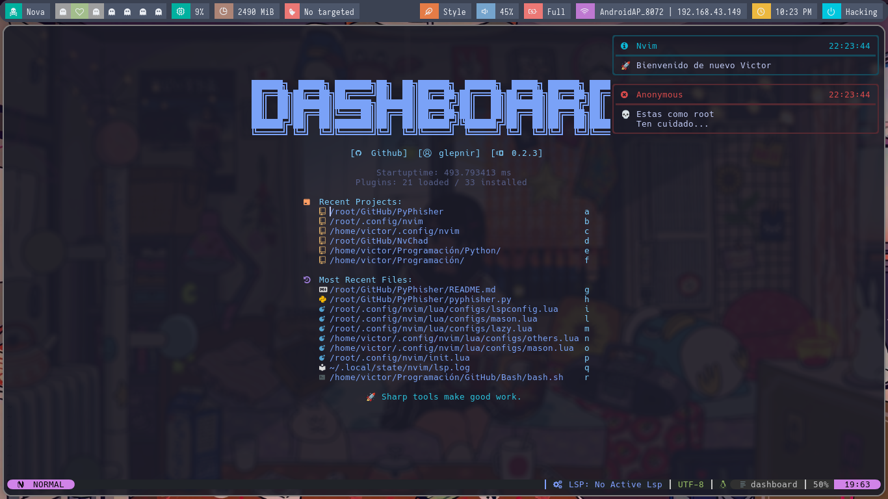

### Probar sin sustituir tu configuración habitual

También puedes clonar el repositorio en una carpeta independiente:

```bash
git clone https://github.com/anonymous-17-03/My_Nvim.git \
  ~/.config/nvim-nova-prueba

NVIM_APPNAME=nvim-nova-prueba nvim
```

Esta opción separa configuración, plugins, estado y caché. Dentro de la sesión de prueba ejecuta igualmente `:MasonInstallAll` y `:TSInstallAll`. Abrir `nvim` sin esa variable sigue utilizando la configuración habitual.

Si ya tienes una carpeta `nvim-nova-prueba`, utiliza otro nombre y usa ese mismo nombre en `NVIM_APPNAME`. El menú NovaHacking también está incluido en esta instalación de prueba.

## Primeros pasos

Abre Neovim desde la carpeta de tu proyecto para que las búsquedas y terminales partan de una ubicación útil:

```bash
cd /ruta/a/tu/proyecto
nvim .
```

También puedes abrir directamente un archivo:

```bash
nvim main.py
```

- Pulsa `i` para entrar en modo inserción y escribir; `Esc` vuelve al modo normal.
- Usa `<leader>ff` para buscar archivos y `<leader>fg` para buscar texto.
- Abre el árbol de archivos con `Ctrl+n` o el menú NovaHacking con `<leader>mh`.
- Guarda con `Ctrl+s` o `:w`. El formato al guardar está activado para los tipos de archivo configurados.
- En autocompletado, navega con `Ctrl+j` y `Ctrl+k`, y confirma la sugerencia seleccionada con `Ctrl+y`.
- Si tienes dudas sobre un atajo, pulsa espacio y consulta Which-key.

Si estás en la instalación de prueba, antepone `NVIM_APPNAME=nvim-nova-prueba` a los comandos que abren Neovim.

## Lenguajes configurados

| Lenguaje | Servidor LSP |
| --- | --- |
| Python | `pyright` |
| Lua | `lua_ls` |
| JavaScript y TypeScript | `ts_ls` |
| Astro | `astro` |
| Svelte | `svelte` |
| Bash | `bashls` |
| C y C++ | `clangd` |
| Go | `gopls` |
| Rust | `rust_analyzer` |
| HTML | `html` |
| PHP | `intelephense` |

Los servidores se declaran en `lua/configs/lspconfig.lua`. El soporte LSP, el resaltado de Tree-sitter y el formateo son componentes distintos: instalar un parser no instala un servidor ni un formateador.

## 🧠 Tecla Líder

La tecla líder (leader key) es el espacio (`<Space>`). En modo normal, pulsa espacio y espera para ver las combinaciones disponibles en Which-key. Por ejemplo, `<leader>ff` significa pulsar espacio, f y f; abre la búsqueda de archivos con Telescope. `<leader>l` abre el grupo de acciones LSP.

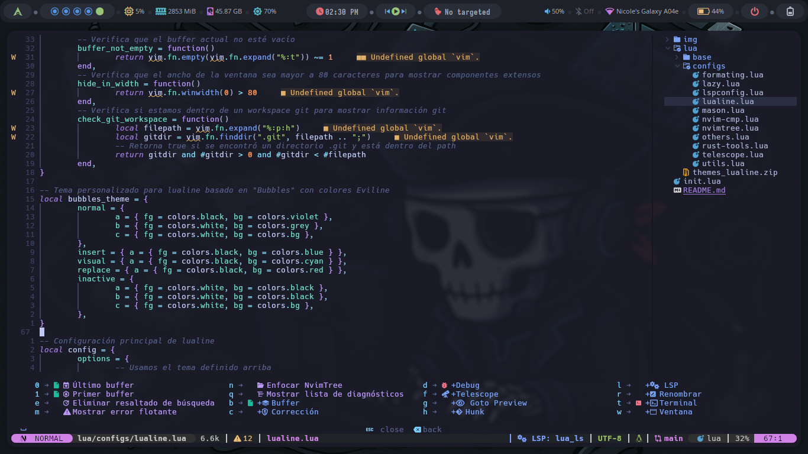

**Captura histórica de CheatSheet:** se conserva como referencia de la personalización anterior. Ese plugin no está habilitado en la versión actual y `<leader>a` no está configurado. Para consultar los atajos disponibles utiliza Which-key: pulsa espacio o `<leader>?` para los del buffer actual.

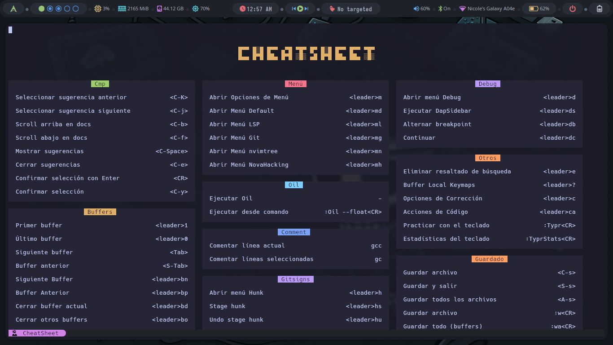

## 🔢 Configurar Números de Línea

Puedes alternar entre números de línea relativos y absolutos en el archivo `lua/base/init.lua`. Las siguientes líneas controlan esta configuración:

```lua
-- Mostrar números de línea
vim.wo.number = true          -- Línea actual en formato absoluto
vim.wo.relativenumber = true  -- Otras líneas en formato relativo
```

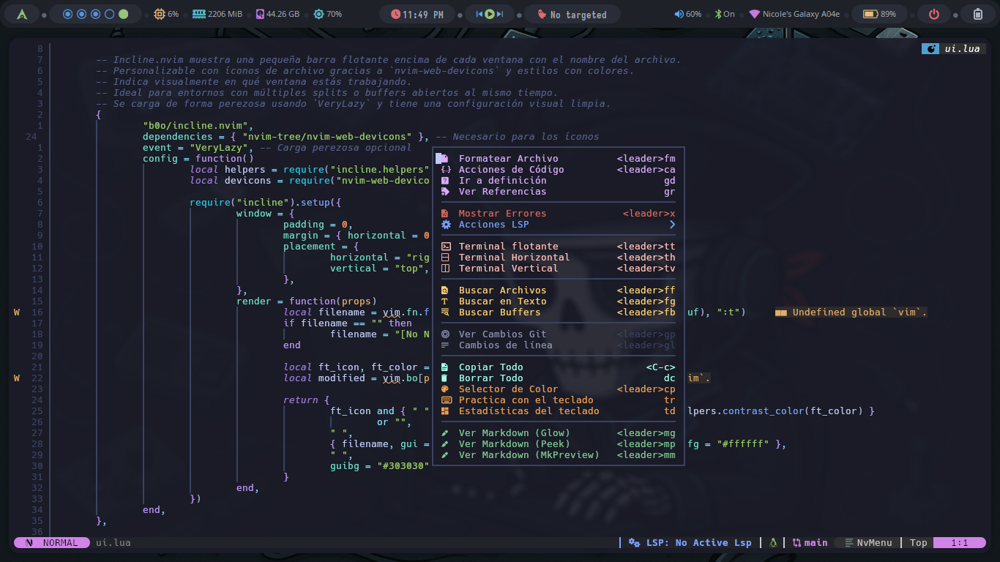

> **Nota**: Para abrir el menú NovaHacking incluido en la configuración, presiona `<leader>mh`. Las opciones visibles pueden variar respecto a la captura.

La línea actual muestra su número absoluto; las demás indican la distancia desde el cursor. Por ejemplo, una línea marcada con `3` está a tres líneas de distancia. Para mostrar solo números absolutos, establece `vim.wo.relativenumber = false`.

## 🎨 Personalizar Apariencia: Fondo y Temas

La apariencia del editor se configura en `lua/plugins_lazy/ui.lua`. Se utiliza **TokyoNight Night** con fondo transparente.

Para un fondo sólido, cambia las opciones del `setup` de TokyoNight:

```lua
transparent = false,
styles = {
    sidebars = "dark",
    floats = "dark",
},
```

Después elimina o comenta el bucle que aplica `guibg=NONE` a `highlight_groups`; de lo contrario seguirá forzando la transparencia de esos elementos. Si prefieres un color específico, puedes sustituir ese bucle por:

```lua
for _, group in ipairs(highlight_groups) do
    vim.api.nvim_set_hl(0, group, { bg = "#1f2335" })
end
```

El fondo final también depende de la transparencia configurada en tu terminal.

#### Transparente

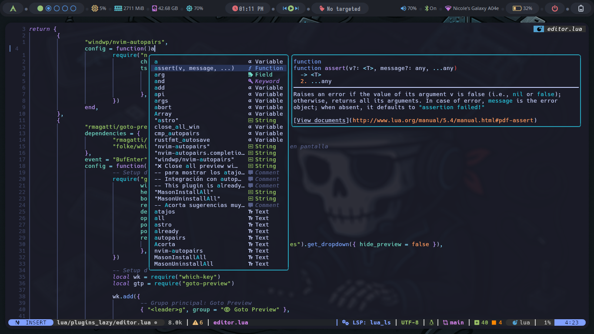

#### Sólido

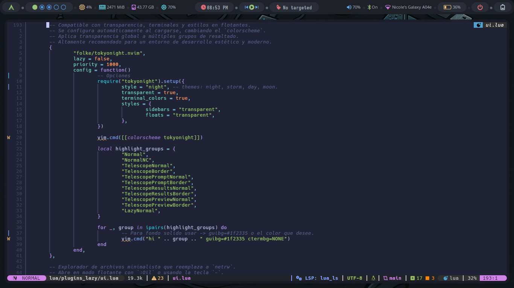

Si deseas utilizar otro tema de colores, adapta su declaración en `lua/plugins_lazy/ui.lua` y su llamada a `colorscheme`.

Para cambiar únicamente la barra de estado, edita `lua/configs/lualine.lua`:

```lua
local theme_name = "NovaHacking"
return require("lualine_themes." .. theme_name)
```

Los valores disponibles son `NovaHacking`, `bubbles`, `slanted`, `evil` y `back`. Cada tema devuelve sus opciones y Lualine se configura una sola vez.

## 🔌 Agregar Nuevos Plugins

Para añadir nuevos plugins utilizando Lazy.nvim, simplemente edita el archivo correspondiente en `lua/plugins_lazy/` según la categoría del plugin. Por ejemplo, si deseas agregar un plugin relacionado con la interfaz de usuario, edita `lua/plugins_lazy/ui.lua` y añade una entrada como la siguiente:

```lua
{
  "autor/plugin-ejemplo",
  config = function()
    require("plugin-ejemplo").setup({})
  end,
},
```

#### Lazy

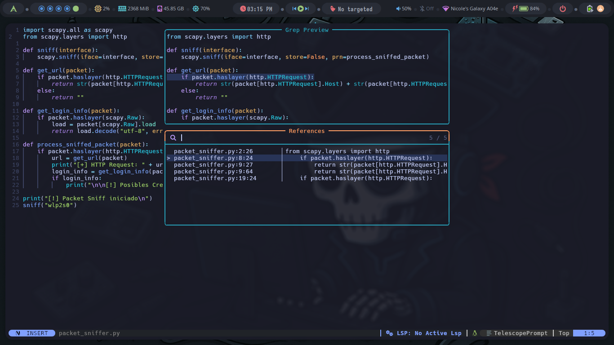

Lazy.nvim se encargará de gestionar la instalación y carga del plugin automáticamente.

## 🧰 Configuración de Mason, LSP y Formateo

### 📦 Mason: herramientas de desarrollo

**Archivo:** `lua/configs/mason.lua`.

La lista de herramientas está en `M.tools`; la interfaz se configura en `M.setup()`. Este es el módulo utilizado por la configuración:

```lua
local M = {}
-- Ejecuta :MasonInstallAll cuando quieras instalar las herramientas de esta lista.
-- rustfmt pertenece al toolchain de Rust, no al registro de Mason.
M.tools = {
	"lua-language-server",
	"stylua",
	"rust-analyzer",
	"pyright",
	"clangd",
	"prettier",
	"black",
	"isort",
	"typescript-language-server",
	"svelte-language-server",
	"codelldb",
	"debugpy",
	"bash-language-server",
	"shfmt",
	"astro-language-server",
	"html-lsp",
	"intelephense",
	"php-cs-fixer",
	"gopls",
	"gofumpt",
	"goimports",
}
function M.setup()
	require("mason").setup({
		ui = {
			border = "rounded",
			icons = {
				package_installed = "✓",
				package_pending = "➜",
				package_uninstalled = "✗",
			},
		},
		max_concurrent_installers = 7,
	})
	vim.api.nvim_create_user_command("MasonInstallAll", function()
		vim.cmd("MasonInstall " .. table.concat(M.tools, " "))
	end, { desc = "Instalar herramientas de NovaHacking" })
end
return M
```

Añadir un nombre a `M.tools` prepara su instalación cuando ejecutes `:MasonInstallAll`. Esta lista no es una opción nativa `ensure_installed` de Mason ni instala herramientas por sí sola al arrancar.

Para una herramienta concreta:

```vim
:MasonInstall shfmt
```

#### Mason

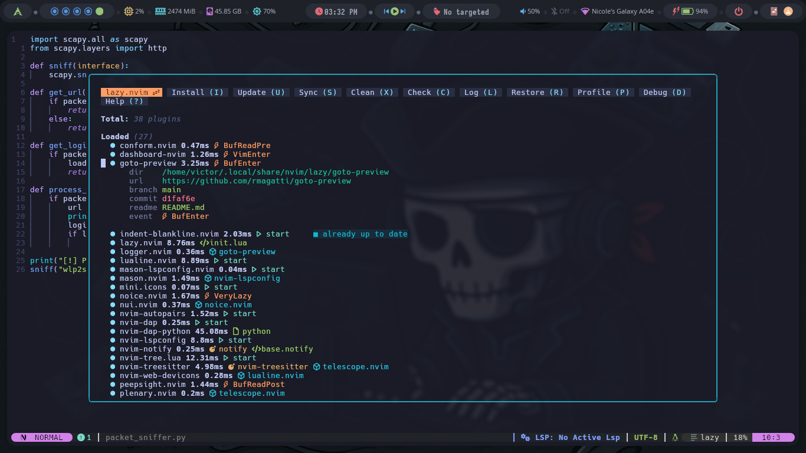

### 🧠 Configurar servidores LSP

**Archivo:** `lua/configs/lspconfig.lua`.

La configuración utiliza `vim.lsp.config()` y `vim.lsp.enable()`. `nvim-lspconfig` aporta las definiciones de los servidores y `cmp-nvim-lsp` sus capacidades de autocompletado.

Por ejemplo, para personalizar Go, añade esta configuración antes de la llamada final a `vim.lsp.enable(servers)`:

```lua
vim.lsp.config("gopls", {
    -- Añade aquí las opciones del servidor que necesite tu proyecto.
})
```

`gopls` ya está incluido en la tabla `servers`. Si añades otro servidor, incorpora su identificador a esa tabla y asegúrate de instalar su ejecutable. El nombre del paquete de Mason puede ser diferente al identificador LSP: por ejemplo, `lua-language-server` y `lua_ls`.

La activación automática de mason-lspconfig está deshabilitada porque esta configuración activa explícitamente su lista de servidores.

### ✨ Formateo automático multilenguaje

**Archivo:** `lua/configs/formatting.lua`.

Conform formatea al guardar y también al pulsar `<leader>lf`. Su configuración es:

```lua
return {
	-- Tabla que define qué formateadores usar por tipo de archivo
	formatters_by_ft = {
		-- Web
		javascript = { "prettier" },
		typescript = { "prettier" },
		javascriptreact = { "prettier" },
		typescriptreact = { "prettier" },
		svelte = { "prettier" },
		css = { "prettier" },
		html = { "prettier" },
		json = { "prettier" },
		yaml = { "prettier" },
		graphql = { "prettier" },
		php = { "php_cs_fixer" },

		-- Lua
		lua = { "stylua" },

		-- Python
		python = { "isort", "black" }, -- isort ordena imports, black formatea el resto

		-- Rust
		rust = { "rustfmt" },

		-- Bash
		bash = { "shfmt" },
		sh = { "shfmt" },

		-- Go
		go = { "gofumpt", "goimports" },
	},

	-- Configuración para el autoformateo al guardar archivos
	format_on_save = {
		lsp_format = "fallback", -- Usar LSP solo si no hay formateador externo disponible
		timeout_ms = 1000, -- Tiempo máximo para el formateo
	},
}
```

`lsp_format = "fallback"` utiliza el formato del LSP cuando no hay un formateador externo disponible. No significa que cualquier error de ejecución de un formateador se sustituya automáticamente por el LSP.

Detalles importantes:

- PHP utiliza el identificador `php_cs_fixer` en Conform; el ejecutable y paquete de Mason se llaman `php-cs-fixer`.
- Python ejecuta `isort` y después `black`.
- Go ejecuta `gofumpt` y después `goimports`.
- Rust usa `rustfmt`; el autoformateo adicional de `rust.vim` está desactivado para evitar duplicación.
- Svelte necesita el soporte correspondiente de Prettier en el entorno del proyecto. Astro tiene LSP y parser configurados, pero no una entrada explícita de formateo en esta tabla.
- Dockerfile no tiene Prettier asignado: no se presupone un parser externo para ese formato.

#### ➕ Añadir un formateador

1. Instala el ejecutable mediante Mason o tu gestor de paquetes.
2. Añade su identificador de Conform al tipo de archivo correspondiente en `formatters_by_ft`.
3. Reinicia Neovim y comprueba `:ConformInfo`.

Por ejemplo, para archivos shell:

```lua
sh = { "shfmt" },
```

### 🌳 Tree-sitter

**Archivo:** `lua/configs/treesitter.lua`.

`:TSInstallAll` instala los parsers de la lista configurada. También puedes instalar uno individualmente:

```vim
:TSInstall rust
```

El resaltado se activa para buffers normales cuando su parser puede cargarse. La pantalla `dashboard` se excluye explícitamente; no necesita un parser. Después de instalar un parser, vuelve a abrir el archivo para activar su resaltado.

### 🐞 Depuración

- C, C++ y Rust usan codelldb, configurado en `lua/configs/dap.lua`.
- Python utiliza nvim-dap-python y el entorno de debugpy instalado por Mason.
- `<leader>db` alterna un breakpoint, `<leader>dc` continúa o inicia la depuración y `<leader>ds` abre el panel de scopes.

Para C, C++ y Rust, compila primero el programa con información de depuración y selecciona su ejecutable cuando se solicite. La configuración no compila el proyecto automáticamente.

## Características

- **Lazy.nvim:** instalación, carga y revisiones de plugins mediante lockfile.
- **LSP nativo:** diagnósticos, navegación, referencias, renombrado y acciones de código.
- **nvim-cmp y LuaSnip:** autocompletado con iconos y snippets.
- **Tree-sitter:** resaltado sintáctico mediante parsers por lenguaje.
- **Telescope:** búsqueda de archivos, texto, buffers, ayuda e historial.
- **Lualine:** barra de estado personalizada con el tema NovaHacking.
- **NvimTree y Oil:** árbol a la derecha y explorador flotante con `-`.
- **Mason y Conform:** gestión de herramientas y formato manual/al guardar.
- **Snacks:** guías de indentación, columna de estado y otras funciones habilitadas en `ui.lua`.
- **Gitsigns y LazyGit:** cambios por archivo e interfaz Git integrada.
- **Spectre:** búsqueda y reemplazo en el proyecto.
- **ToggleTerm:** terminales flotantes, horizontales y verticales.
- **nvim-dap:** configuración de depuración para C, C++, Rust y Python.
- **Glow:** previsualización de Markdown con `:Glow`.
- **Menú NovaHacking:** menú personalizado incluido en `lua/menus/novahacking.lua`.
- **Noice, Notify, Incline, Which-key y dashboard:** interfaz, notificaciones y acceso a herramientas.

`MarkdownPreview`, `PeekOpen` y CheatSheet no están habilitados en esta versión.

## ⌨️ Atajos principales

`<leader>` equivale a espacio. Las combinaciones se pulsan en modo normal salvo las de autocompletado.

| Atajo | Acción |
| --- | --- |
| `<leader>ff` / `<leader>fg` | Buscar archivos / texto. |
| `<leader>fb` / `<leader>fr` | Buffers / archivos recientes. |
| `<C-n>` / `<leader>n` | Alternar / enfocar NvimTree. |
| `-` | Abrir Oil flotante. |
| `<Tab>` / `<S-Tab>` | Buffer siguiente / anterior. |
| `<leader>bd` | Cerrar el buffer actual. |
| `<leader>bo` | Cerrar otros buffers limpios; conservar modificados y terminales. |
| `<C-s>` / `<A-s>` | Guardar archivo / guardar todos. |
| `S` (Shift+s) | Guardar y salir del archivo actual. |
| `<leader>lf` | Formatear con Conform. |
| `<leader>la` / `<leader>ca` | Acciones de código. |
| `<leader>lr` | Renombrar un símbolo. |
| `<leader>lh` | Documentación del símbolo. |
| `<leader>lgd` / `<leader>lgr` | Definición / referencias. |
| `[d` / `]d` | Diagnóstico anterior / siguiente. |
| `<leader>li` / `<leader>ln` | Salud LSP / información de los clientes del buffer. |
| `<leader>tf` / `<leader>th` / `<leader>tv` | Terminal flotante / horizontal / vertical. |
| `<leader>hg` | Abrir LazyGit. |
| `<leader>hs` / `<leader>hr` / `<leader>hp` | Stage / reset / previsualizar hunk. |
| `<leader>s` | Abrir Spectre. |
| `<leader>mh` | Abrir el menú NovaHacking incluido. |
| `<leader>?` | Mostrar atajos locales del buffer. |
| `<C-j>` / `<C-k>` en inserción | Sugerencia siguiente / anterior. |
| `<C-y>` en inserción | Confirmar la sugerencia seleccionada. |

## 🔄 Actualización y diagnóstico

Para obtener cambios del repositorio, revisa primero si tienes modificaciones locales:

```bash
cd ~/.config/nvim
git status
git pull --ff-only
```

Si tienes cambios propios, guárdalos o intégralos antes de actualizar. `--ff-only` evita crear un merge automáticamente cuando las historias divergen.

Para aplicar las revisiones de plugins del lockfile:

```vim
:Lazy restore
```

Para buscar revisiones nuevas de plugins, utiliza `:Lazy update` y revisa los cambios de `lazy-lock.json` antes de guardarlos en Git. Este archivo no fija las versiones de herramientas de Mason ni de parsers.

Después de actualizar Tree-sitter, actualiza sus parsers con `:TSUpdate`.

| Comando | Qué revisar |
| --- | --- |
| `:checkhealth` | Estado general y dependencias. |
| `:checkhealth vim.lsp` | Servidores y clientes LSP. |
| `:Mason` | Instalaciones y errores de herramientas. |
| `:ConformInfo` | Formateadores disponibles y registro de errores. |
| `:messages` | Mensajes del editor. |
| `:Lazy` | Estado de los plugins. |

Si los iconos aparecen como cuadros, comprueba la Nerd Font de tu terminal. Si un lenguaje no tiene resaltado, instala su parser y reabre el archivo. Si no hay autocompletado LSP, comprueba el servidor correspondiente y la raíz del proyecto.

### Error al compilar parsers: `tree-sitter` no encontrado

Si `:TSInstallAll` o `:TSInstall cpp` muestra un mensaje como este:

```text
[nvim-treesitter/install/cpp] error: Error during "tree-sitter build":
ENOENT: no such file or directory (cmd): 'tree-sitter'
```

Neovim no encuentra el ejecutable necesario para compilar el parser. En Arch Linux:

```bash
sudo pacman -S --needed tree-sitter-cli
command -v tree-sitter
tree-sitter --version
```

Vuelve a Neovim y comprueba:

```vim
:echo executable('tree-sitter')
```

Cuando devuelva `1`, repite `:TSInstallAll`. Si solo quieres reintentar el parser de C++:

```vim
:TSInstall cpp
```

Si la terminal encuentra el ejecutable pero Neovim sigue devolviendo `0`, cierra Neovim y ábrelo desde esa terminal para que herede su entorno actualizado. Este error no requiere borrar la caché, eliminar los datos de Neovim ni reinstalar la configuración.

## Capturas de Pantalla

Se conservan las capturas del repositorio como referencia visual: el tema, los colores y la distribución general se mantienen. Algunos detalles de los menús, mensajes o versiones de plugins pueden variar. La captura de CheatSheet está identificada como histórica en su sección.


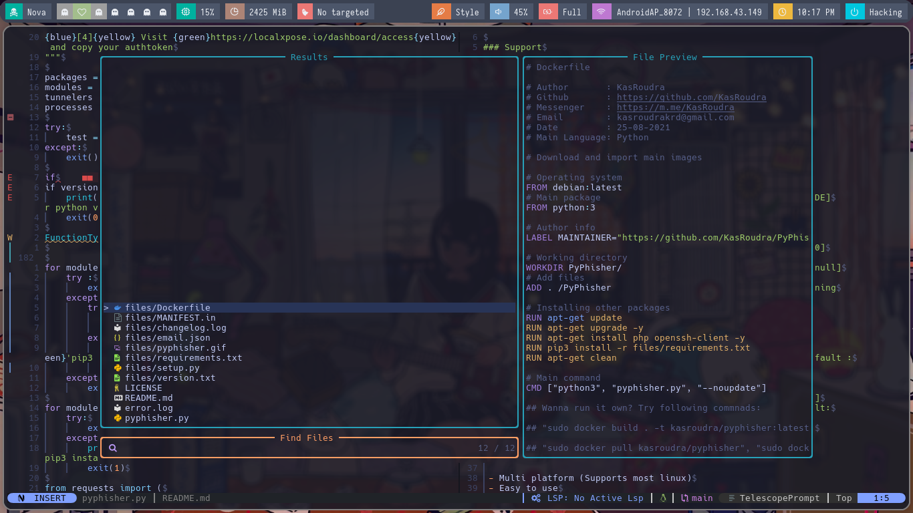

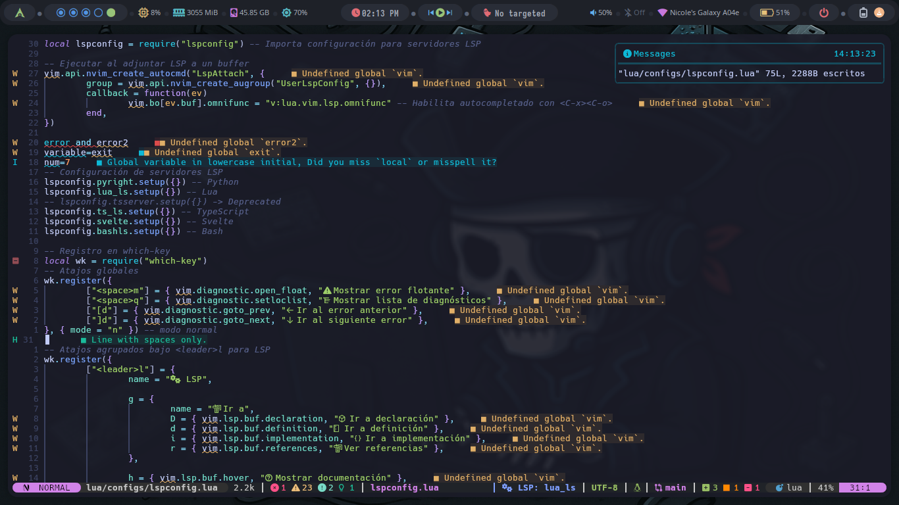


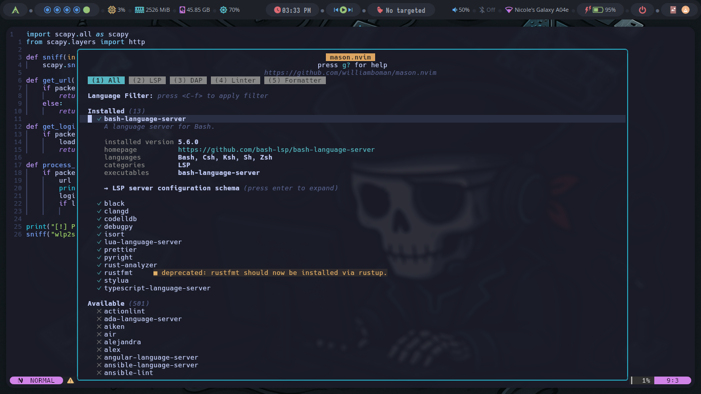

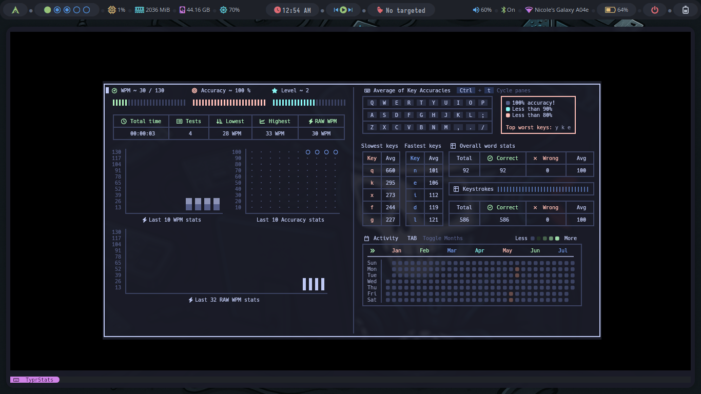

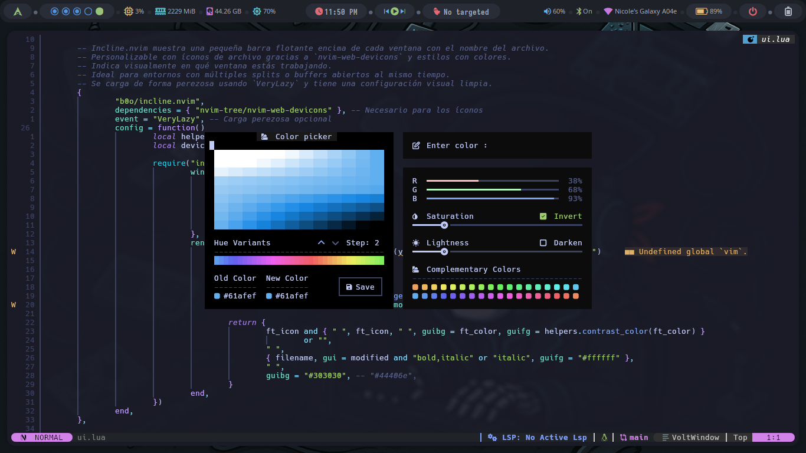

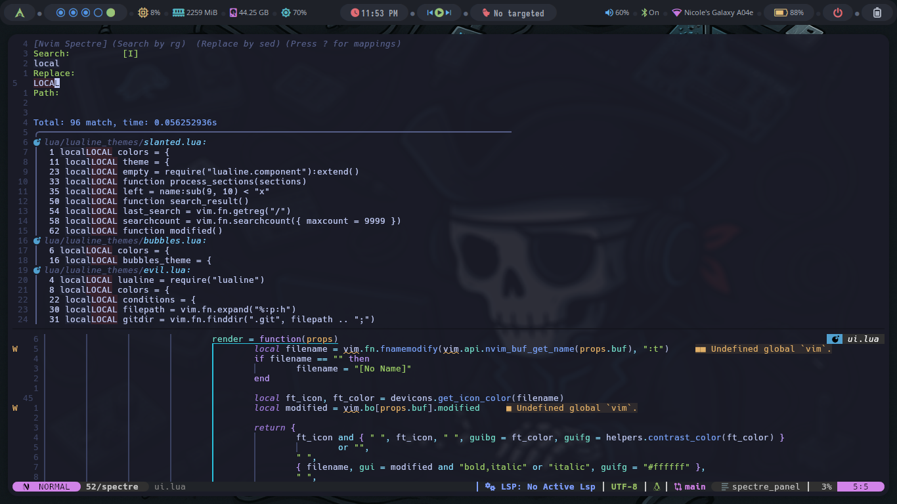

## Créditos

[FStanDev](https://youtu.be/RYAfhkw_1QQ?si=A1tYsU0XbrQSYIlG) por la inspiración inicial.

## Contribuciones

Las contribuciones son bienvenidas. Puedes crear un fork para adaptar la configuración a tu flujo de trabajo y abrir un issue o pull request para proponer cambios.

Al reportar un problema, incluye la versión de Neovim, tu sistema operativo, los pasos para reproducirlo y el mensaje de error completo. Si afecta a un lenguaje, indica también el servidor LSP o formateador implicado y el resultado relevante de `:checkhealth` o `:ConformInfo`.